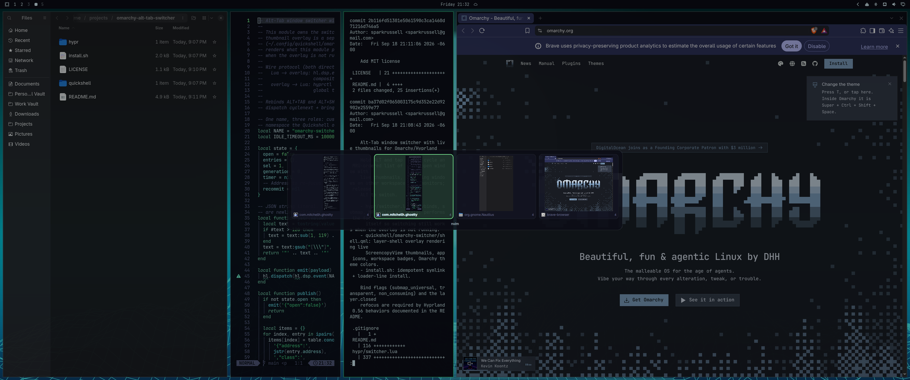
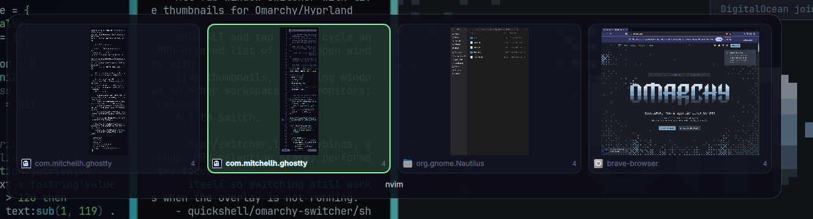

# Live Alt-Tab

A hold-to-preview Alt-Tab window switcher for [Omarchy](https://omarchy.org/) /
Hyprland: hold `ALT`, tap `TAB` to cycle, and a centered card shows **live
thumbnails** of every open window — including windows on other workspaces and
other monitors. Release `ALT` to switch.

No new packages: the key handling is Hyprland's own Lua config API, and the
overlay is an Omarchy shell plugin ([Quickshell](https://quickshell.org/)) using
`ScreencopyView` against each window's Wayland toplevel.



Selection is highlighted with the theme's accent color; each cell carries the
app icon, its class, and the workspace it lives on, with the selected window's
title underneath:



## Requirements

- Hyprland 0.56+ with the Lua config (Omarchy's `~/.config/hypr/*.lua` layout)
- Quickshell 0.3+ (`quickshell` package; ships with Omarchy)

## Install

This is an [Omarchy shell plugin](https://plugins.omarchy.org/): the overlay
runs inside `omarchy-shell` as a service.

```bash
omarchy plugin add https://github.com/sparkrussell/omarchy-alt-tab-switcher.git --enable
```

Plugins can't register Hyprland keybinds, so add the key handling to
`~/.config/hypr/hyprland.lua` yourself. The existence check keeps your
Hyprland config loading if the plugin is later removed:

```lua
-- Alt-Tab window switcher (Omarchy plugin io.github.sparkrussell.alt-tab-switcher).
local alt_tab = os.getenv("HOME") .. "/.config/omarchy/plugins/io.github.sparkrussell.alt-tab-switcher/hypr/switcher.lua"
local alt_tab_file = io.open(alt_tab)
if alt_tab_file then
  alt_tab_file:close()
  dofile(alt_tab)
end
```

Then `hyprctl reload`. Update later with
`omarchy plugin update io.github.sparkrussell.alt-tab-switcher`, then
`omarchy restart shell` (the overlay is a `keepLoaded` service, so new code only
loads on a shell restart) and `hyprctl reload` (for `hypr/switcher.lua`).

## Keys

| Key | Action |
|---|---|
| `ALT + TAB` | Open the switcher / advance (first tap preselects the previous window) |
| `ALT + SHIFT + TAB` | Open backwards / step back |
| `ALT + →` / `ALT + ←` | Step forward / back |
| release `ALT`, or `RETURN` | Switch to the selected window |
| `ESC`, or `ALT + Q` | Cancel |
| mouse | Hover selects, click switches, click outside the card cancels |

Windows are ordered most-recently-used (Hyprland's `focus_history_id`), so a
quick `ALT+TAB` tap behaves like classic Alt-Tab. Hidden windows (e.g. swallowed
terminals) are skipped. An unattended switcher cancels itself after 10 s.

## Design

Two halves, talking over Hyprland's own IPC:

```
hypr/switcher.lua (Hyprland Lua)          Service.qml (omarchy-shell plugin)
  keybinds, submap, MRU list, selection       thumbnails, labels, theming
             |  hl.dsp.event("omarchy-switcher>>{json}")  ->  custom>> on socket2
             |  <-  hyprctl dispatch 'omarchy_switcher.pick("0x…")'
```

The Lua module is the single source of truth and performs the focus itself, so
**if the plugin is disabled, Alt-Tab still switches windows** — you
just lose the visuals.

Public Lua entry points (also usable from scripts or your own binds):

```bash
hyprctl dispatch 'omarchy_switcher.open(1)'      # open / advance
hyprctl dispatch 'omarchy_switcher.open(-1)'     # open backwards
hyprctl dispatch 'omarchy_switcher.step(1)'
hyprctl dispatch 'omarchy_switcher.commit()'
hyprctl dispatch 'omarchy_switcher.cancel()'
hyprctl dispatch 'omarchy_switcher.pick("0x55…")'
```

Theme colors are read live from
`~/.local/state/omarchy/current/theme/colors.toml`, so the card follows
`omarchy theme set`.

## Four Hyprland behaviors this works around

Verified against Hyprland v0.56.2 source; all four are why the bind flags look
the way they do.

1. **Release binds are matched against the submap that was active when the key
   went down** (`KeybindManager.cpp`, `submapAtPress`). `ALT` goes down before
   `ALT+TAB` enters the switcher submap, so a submap-scoped `Alt_L` release bind
   never matches — hence `submap_universal` plus a state check.
2. **`shadowKeybinds()` shadows every bind whose key is still held**, so
   triggering `ALT+TAB` shadows the `Alt_L` release bind. Only `global` and
   `transparent` binds are exempt — hence `transparent`.
3. **A consumed `ALT` release never reaches the focused client**, leaving apps
   believing `ALT` is stuck down — hence `non_consuming`.
4. **Hyprland refocuses a monitor's last window when a layer that held pointer
   focus unmaps** (`LayerSurface.cpp` `onUnmap`), which silently undid the
   switch. The target is therefore re-focused on the `layer.closed` event.

Also worth knowing: `hl.unbind` is not submap aware, so Omarchy's default
`ALT+TAB` binds must be removed *before* the submap registers its own; and
`HL.Timer` has no `stop()` — a oneshot is cancelled with `set_enabled(false)`.

## Uninstall

```bash
omarchy plugin remove io.github.sparkrussell.alt-tab-switcher
```

Then delete the Alt-Tab block from `~/.config/hypr/hyprland.lua` and run
`hyprctl reload`. Omarchy's stock `ALT+TAB` bindings come back on reload.

## CI is the local gate

`scripts/ci-local.sh` is the authoritative gate for this repo — it is what decides whether a change is
good. `.github/workflows/ci.yml` is retained only as the record of what the gate mirrors: it no longer
triggers on push or on pull request (it is `workflow_dispatch` only), so a check there says nothing
about a commit.

```bash
bash scripts/ci-local.sh            # run the gate
bash scripts/ci-local.sh --strict   # merge gate: a SKIP counts as a failure
```

All three checks always run, each keeps its own log, and the command exits non-zero if any of them
failed:

| Step | Check | Needs |
|---|---|---|
| a | `luacheck hypr/switcher.lua`, honouring `.luacheckrc` | `luacheck` |
| b | `qmlformat Service.qml` — grammar parse only (no module resolution); a syntax error exits non-zero, and an exit 0 that does not return the whole document (empty, whitespace-only, truncated) fails too | `qmlformat` (Qt 6) |
| c | the jq assertions at the core of `omarchy plugin validate` (schemaVersion 1, `id` shape and non-reserved `omarchy.` prefix, `name`/`version`, `kinds == ["service"]`, `entryPoints.service == "Service.qml"`), then that `Service.qml` exists and the plugin folder holds no symlinks | `jq` |

Quickshell's QML modules cannot be installed everywhere, so a full `qmllint` type-check would drown
in unresolved-import noise; `qmlformat` parses the grammar without module resolution, which is the
regression worth catching.

**A missing tool is a SKIP, never a silent pass.** The step says which tool is missing and prints the
exact install command, and the run warns that the gate is degraded.

#### Installing the tools

`luacheck` must be built against **Lua 5.4**. On Arch, `luarocks` defaults to Lua 5.5, and a luacheck
installed that way resolves its modules from a `5.5` tree and dies on the first require:

```
lua5.5: .../luacheck/standards.lua:134: attempt to assign to const variable 'field_name'
```

A plain `luarocks install luacheck` is therefore not enough, and a Lua 5.5 build sitting earlier on
`PATH` is worse than no luacheck at all. `luarocks` and the 5.4 interpreter are prerequisites — install
into a 5.4 tree and link it onto `PATH`:

```bash
sudo pacman -S --needed luarocks lua54
mkdir -p "$HOME/.local/bin"
luarocks --lua-version=5.4 --tree="$HOME/.luarocks54" install luacheck 1.2.0
ln -sfn "$HOME/.luarocks54/bin/luacheck" "$HOME/.local/bin/luacheck"
```

`~/.local/bin` must be on `PATH`. Confirm the build before trusting the gate — `luacheck --version`
has to report both lines:

```
Luacheck: 1.2.0
Lua: PUC-Rio Lua 5.4
```

`qmlformat` comes from Qt 6:

```bash
sudo pacman -S --needed qt6-declarative     # provides /usr/lib/qt6/bin/qmlformat
```

The gate falls back to `/usr/lib/qt6/bin/qmlformat` when it is not on `PATH`.

`jq` is required for step c: without it the manifest check fails loudly rather than skipping
(`sudo pacman -S --needed jq`).

### Install the pre-push hook (opt-in)

```bash
bash scripts/install-git-hooks.sh              # install
bash scripts/install-git-hooks.sh --uninstall  # remove
```

The hook checks out each distinct pushed commit into a temporary detached worktree and runs that
tree's `scripts/ci-local.sh`, blocking the push on failure. It ignores tag pushes and branch
deletions. Re-running the installer is a no-op; a pre-existing foreign `pre-push` hook is kept as
`pre-push.bak-<timestamp>`.

By default the hook runs the gate **without** `--strict`, so a SKIP does not block a push. Push with
`CI_LOCAL_STRICT=1` to make the hook enforce the merge rule — a missing tool then blocks the push:

```bash
CI_LOCAL_STRICT=1 git push     # SKIP counts as a failure, same as --strict
```

The bypass is explicit and loud: `CI_LOCAL_SKIP=1 git push` (git's own `--no-verify` also skips
hooks, silently — don't).

### Merge rule

A PR merges only when `bash scripts/ci-local.sh --strict` exits 0 — `3 passed, 0 failed, 0 skipped`.
Without `--strict` a SKIP is not a failure, so a degraded run is not a merge signal — it means the
gate has not looked at that step yet. The pre-push hook does not enforce this unless you push with
`CI_LOCAL_STRICT=1`.

## License

MIT — see [LICENSE](LICENSE). Contributions and forks welcome.
